# MkulimaFeeds

> **A full-stack agricultural commerce platform** digitizing Kenya's animal-feed supply chain — from farm to dealer to customer. Built end-to-end with Kotlin on both client and server.

[](https://kotlinlang.org/)
[](https://developer.android.com/)
[](https://ktor.io/)
[](https://www.postgresql.org/)
[](./LICENSE)
[](https://github.com/Movin-onyango/MkulimaFeeds/actions/workflows/ci.yml)

---

## 📖 Overview

MkulimaFeeds is a production-grade mobile platform that digitizes the animal-feed supply chain in Kenya. It serves **four distinct user roles** — Customer, Dealer, Staff, and Admin — each with a tailored experience covering the full business lifecycle: authentication, catalog browsing, cart & checkout, order fulfilment, dealer management, and administrative analytics.

### Why This Project Matters

- **Real-world domain** — built around an actual Kenyan agri-business problem.
- **Role-based architecture** — four user roles with granular RBAC on both client and server.
- **Full-stack ownership** — native Android app + Ktor backend + PostgreSQL, designed and built end-to-end.
- **Production concerns** — JWT auth, bcrypt hashing, OTP rate limiting, soft deletes, audit logging.
- **Reproducible setup** — one `docker compose up` command gives a fully seeded, working environment.

---

## 🏗️ Architecture

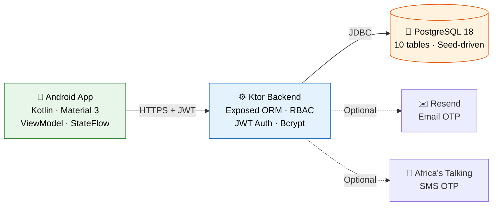

The backend is fully stateless — every request carries a JWT and reads/writes directly to PostgreSQL via Exposed. The database is auto-seeded on first boot through Docker's `docker-entrypoint-initdb.d` mechanism, making the entire stack reproducible from a fresh clone.

---

## ✨ Key Features

### 👤 Customer
- Two-step registration with email/SMS OTP verification
- Product catalog with category filters and search
- Cart, checkout, saved delivery locations
- Visual order tracking timeline
- Profile management, password change, account deletion

### 🚚 Dealer
- Dashboard with KPIs and upcoming deliveries
- View & update assigned orders
- Manage assigned customers
- Performance reports (completion rate, earnings)

### 🛡️ Admin
- Real-time business intelligence dashboard
- Product CRUD with image uploads
- User management (promote, demote, suspend, reactivate)
- Dealer application review workflow
- Configurable business rules
- Role-change audit log

### ⚙️ Backend Highlights
- **RBAC engine** — central permission map with 25+ permissions across 4 roles
- **OTP system** — bcrypt-hashed codes, TTL, attempt limits, per-destination rate limiting
- **Order state machine** — validated status transitions (`PENDING → CONFIRMED → PROCESSING → READY → COMPLETED`)
- **Inventory integrity** — automatic stock adjustment on order confirm/cancel
- **Settings service** — runtime-editable business rules without redeploys

---

## 🛠️ Tech Stack

| Layer | Technology |
|---|---|
| **Frontend** | Kotlin, Android SDK, Material 3, ViewModel, StateFlow, Ktor Client |
| **Backend** | Kotlin, Ktor 3.x, Exposed ORM, JWT (Auth0), Bcrypt |
| **Database** | PostgreSQL 18 |
| **Integrations** | Resend (email), Africa's Talking (SMS) |
| **Tooling** | Gradle (Kotlin DSL), Logback, kotlinx.serialization |
| **Orchestration** | Docker Compose (Postgres + Ktor backend) |

---

## 📂 Project Structure

```
MkulimaFeeds/
├── android-app/            Android client (Kotlin, XML, Material 3)
│   └── app/src/main/
│       ├── java/com/mkulimafeeds/    Activity + ViewModel + Repository
│       └── res/                      Layouts, drawables, themes
├── backend/                Ktor server (Kotlin, Exposed, PostgreSQL)
│   ├── seed/
│   │   └── seed.sql        Auto-loaded on first DB init
│   ├── uploads/products/   Product images (served from /api/products/{id}/image)
│   └── src/main/kotlin/
│       ├── config/         Database, JWT, dependency wiring
│       ├── database/       Tables + initializer
│       ├── models/         Serialization DTOs
│       ├── repository/     Data access layer
│       ├── routes/         HTTP endpoints
│       ├── security/       RBAC, validators, JWT, OTP
│       └── service/        Business logic
├── docs/                   Architecture and API documentation
├── docker-compose.yml      Postgres 18 + Ktor backend
└── README.md
```

---

## 🚀 Getting Started

Two ways to run the backend: **Docker** (recommended, zero-config) or **locally** (requires PostgreSQL + JDK 21).

### Prerequisites

| Tool | Docker Route | Local Route |
|---|---|---|
| **Docker Desktop** | ✅ Required | ❌ Not needed |
| **JDK 21+** | ❌ Not needed | ✅ Required |
| **PostgreSQL 18+** | ❌ Not needed (containerized) | ✅ Required |
| **Android Studio** | ✅ For running the mobile app | ✅ For running the mobile app |

---

### Option 1 — Run with Docker (Recommended)

If you have Docker Desktop installed:

```bash
git clone https://github.com/Movin-onyango/MkulimaFeeds.git
cd MkulimaFeeds

# 1. Copy the environment template
cp .env.example .env

# 2. Edit .env — set DB_PASSWORD and JWT_SECRET at minimum.
#    Tip: generate a JWT_SECRET with:
#      openssl rand -base64 48

# 3. Build and start
docker compose up -d

# 4. Verify
curl http://localhost:8080/api/health
# → {"status":"OK","service":"MovoFeeds Backend","message":"Backend is running"}
```

The backend is now live at `http://localhost:8080`, and PostgreSQL is running on the internal Docker network.

On the first boot, PostgreSQL automatically loads `backend/seed/seed.sql`, populating the database with:

- **1 admin**, **5 customers**, **3 dealers**
- **45 products** across Poultry, Dairy, Pig, Feeds, Supplements, and more
- **16 product images** served from `backend/uploads/products/`
- Full settings catalogue (business rules, tier thresholds, branding)

**Common commands:**

```bash
# Stop everything (data persists in the volume)
docker compose down

# Stop AND wipe the database (re-seeds on next boot)
docker compose down -v

# View backend logs
docker compose logs -f backend

# View Postgres logs
docker compose logs -f postgres

# Open a psql shell
docker compose exec postgres psql -U mkulimafeeds_app -d mkulimafeeds_db
```

---

### Option 2 — Run Locally (Without Docker)

If you don't have Docker installed, or prefer to run directly:

**Step 1 — Set up PostgreSQL 18+**

Install PostgreSQL locally, then create the database and user:

```sql
CREATE DATABASE mkulimafeeds_db;
CREATE USER mkulimafeeds_app WITH ENCRYPTED PASSWORD 'your-secure-password';
GRANT ALL PRIVILEGES ON DATABASE mkulimafeeds_db TO mkulimafeeds_app;
```

**Step 2 — Configure environment variables**

Export these in your shell (or create `.env` in `backend/`):

```bash
export DB_HOST=localhost
export DB_PORT=5432
export DB_NAME=mkulimafeeds_db
export DB_USER=mkulimafeeds_app
export DB_PASSWORD=<your-secure-password>
export JWT_SECRET=<generate-with-openssl-rand-base64-48>
```

**Step 3 — Run the backend**

```bash
cd backend
./gradlew run
```

The API starts on `http://localhost:8080`. On first run, Exposed automatically creates all 10 tables.

**Step 4 — (Optional) Load seed data**

If you want the same seeded environment as Docker, load the seed manually:

```bash
psql -U mkulimafeeds_app -d mkulimafeeds_db -f backend/seed/seed.sql
```

**Step 5 — (Optional) Send real OTPs**

By default, OTPs are logged to the console instead of being sent. To enable real delivery:

```bash
export RESEND_API_KEY=re_...          # https://resend.com (free tier)
export AT_API_KEY=atsk_...            # https://africastalking.com (sandbox)
export AT_USERNAME=sandbox
```

Without these, verification codes still work — they appear in the backend console output instead of arriving via email/SMS.

---

### Running the Android App

The app connects to the backend at `http://10.0.2.2:8080/` by default — that's the special IP the Android emulator uses to reach the host machine's `localhost`.

**Setup:**

1. Ensure the backend is running (`docker compose up -d` or `./gradlew run`)
2. Open `android-app/` in Android Studio
3. Sync Gradle (`./gradlew --refresh-dependencies` if needed)
4. Build & Run on an emulator

**For a physical device** (via USB):

```bash
adb reverse tcp:8080 tcp:8080
```

Then change `BASE_URL` in `app/build.gradle.kts` to `http://127.0.0.1:8080/`.

**For a deployed backend:** change `BASE_URL` to your server's public URL.

---

## 🔑 Demo Credentials

The auto-seeded database includes a test customer account for quick evaluation:

| Role | Email | Password |
|---|---|---|
| Customer | `testcustomer@movofeeds.com` | `Password123` |
| Dealer | `dealer@movofeeds.com` | *(password hash available in seed)* |
| Admin | *(see `backend/seed/seed.sql`)* | *(password hash in seed)* |

> **Note:** The `testcustomer` account is provided for demo purposes only. For the admin and dealer accounts, the password hashes are stored in `backend/seed/seed.sql`. To reset any account to a known password, use the backend's `PasswordHasher` utility to generate a fresh bcrypt hash and `UPDATE users SET password_hash = '<hash>' WHERE email = '...';`.

---

## 🧪 API Quick Test

Verify the running backend with curl:

```bash
# Health check
curl http://localhost:8080/api/health
# → {"status":"OK","service":"MovoFeeds Backend","message":"Backend is running"}

# Login as the demo customer
curl -X POST http://localhost:8080/api/auth/login \
  -H "Content-Type: application/json" \
  -d '{"identifier":"testcustomer@movofeeds.com","password":"Password123"}'
# → {"token":"eyJ...","user":{"id":2,"role":"CUSTOMER",...}}

# Register a new account (initiates OTP — check backend logs for the code)
curl -X POST http://localhost:8080/api/auth/register/initiate \
  -H "Content-Type: application/json" \
  -d '{"name":"Demo User","email":"demo@yourdomain.com","password":"password123"}'
# → {"status":"OK","channel":"EMAIL","destination":"demo@yourdomain.com"}

# Browse the public catalog (no auth required)
curl http://localhost:8080/api/products | head -c 500
```

Full endpoint reference: [`docs/api.md`](docs/api.md).

---

## 📸 Screenshots

### 🛒 Customer Experience

| Home & Featured | Product Catalog | Shopping Cart | Checkout |
|---|---|---|---|
| 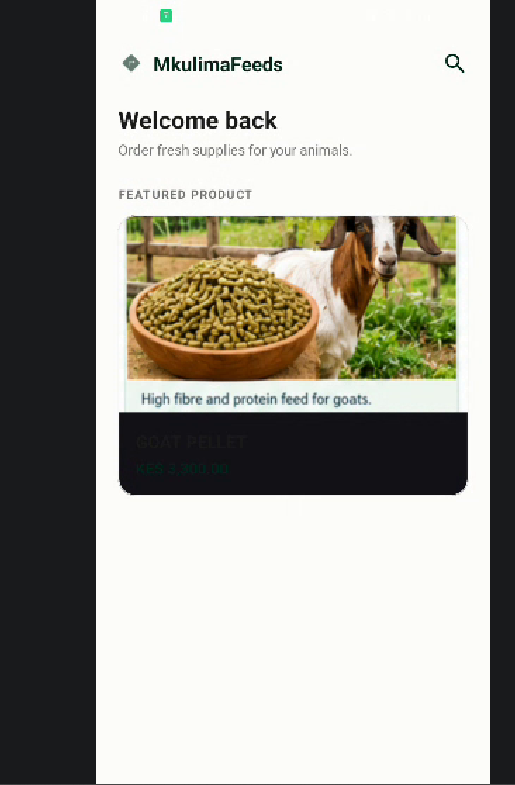 | 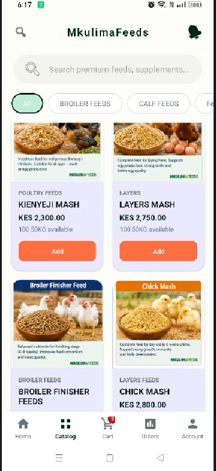 | 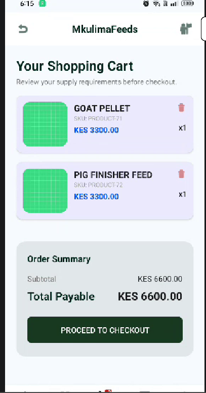 | 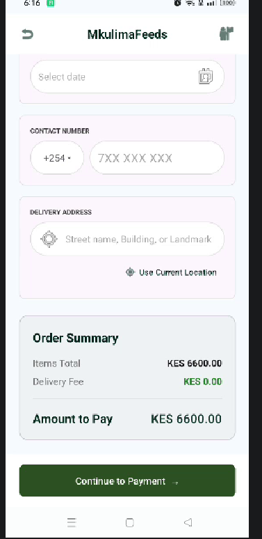 |

| My Orders | Customer Account | Saved Locations | Theme Selection |
|---|---|---|---|
| 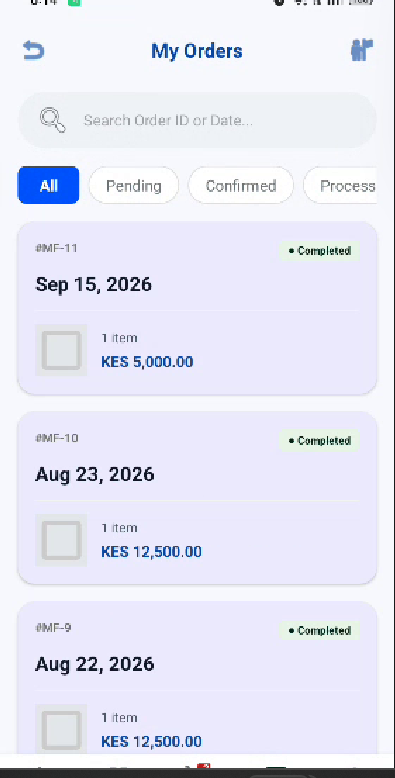 | 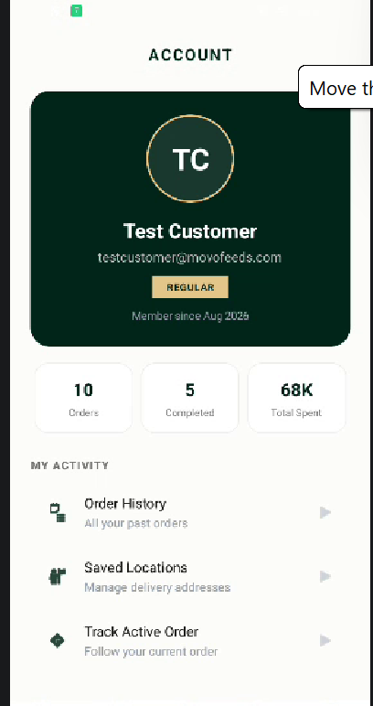 | 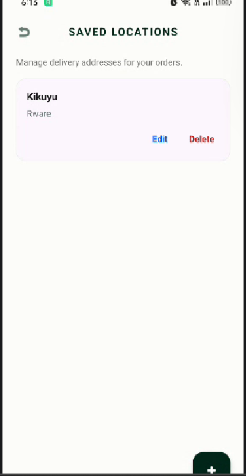 | 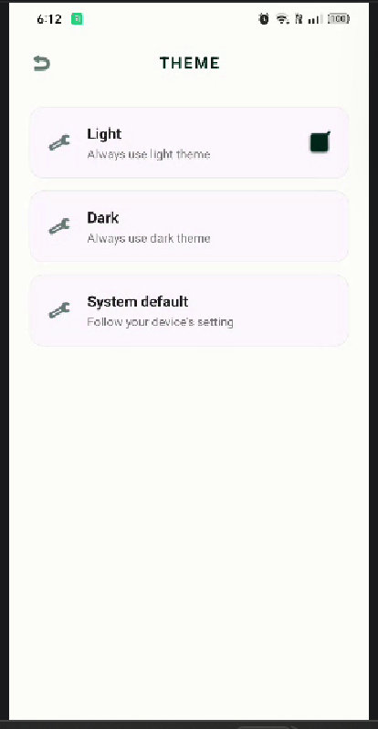 |

| Settings & Support | Saved Locations (Dark) | | |
|---|---|---|---|
| 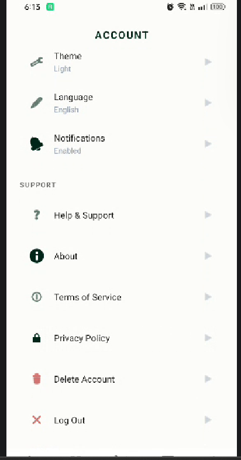 | 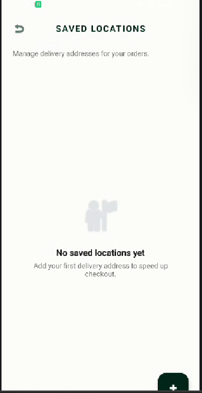 | | |

### 🛡️ Admin Console

| Admin Console | Product Management | Business Intelligence | Analytics Dashboard |
|---|---|---|---|
| 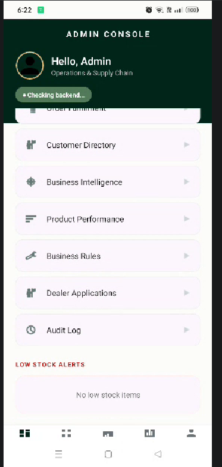 | 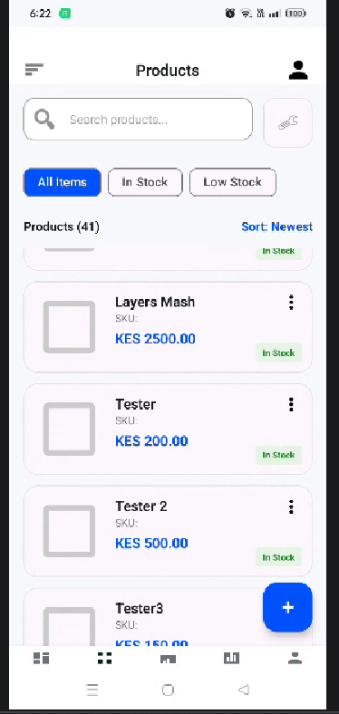 | 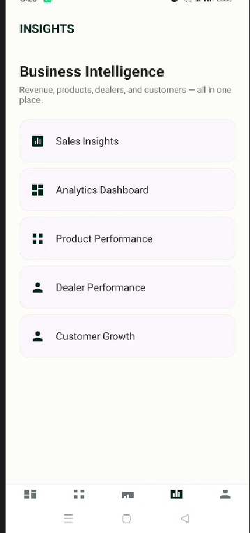 | 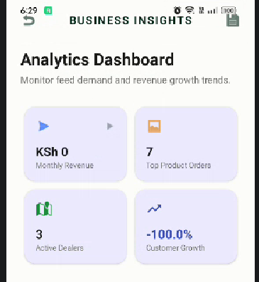 |

| BI Detail | Analytics Detail | Dealer Audit | Customer Directory |
|---|---|---|---|
| 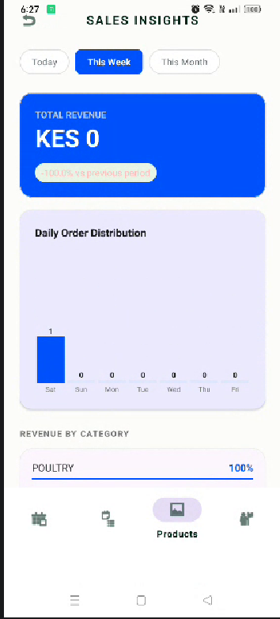 |  | 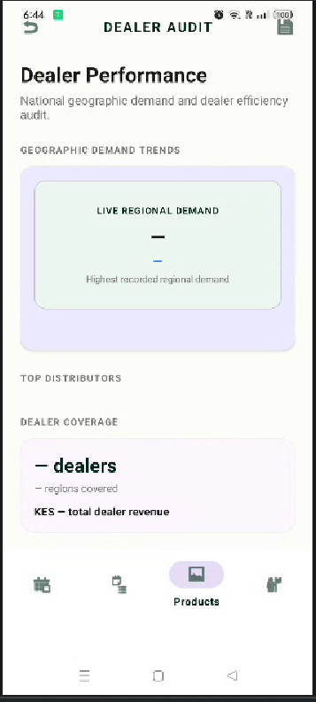 | 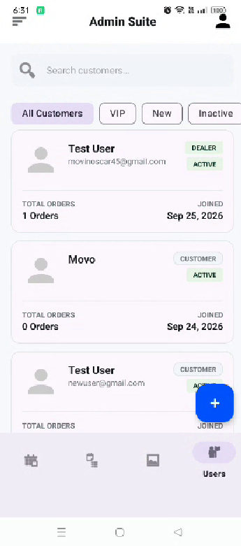 |

| Dealer Applications | Business Rules | | |
|---|---|---|---|
| 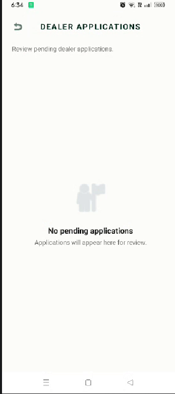 | 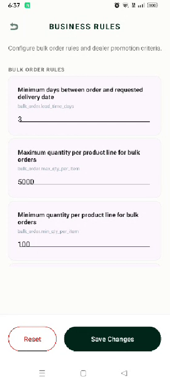 | | |

### 🚚 Dealer Experience

| Dealer Dashboard | Dealer Account | Dealer Orders | Dealer Catalog |
|---|---|---|---|
| 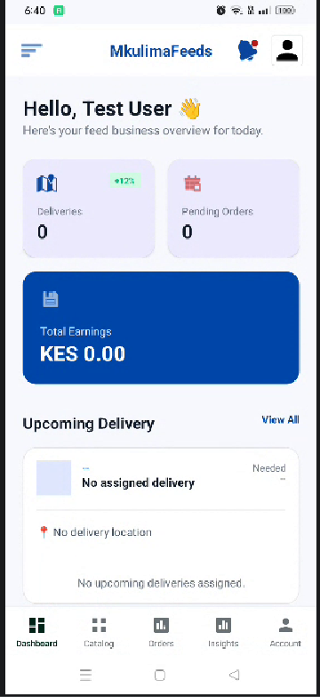 | 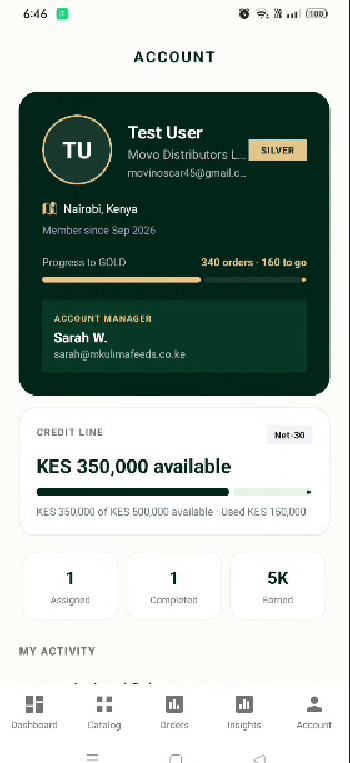 | 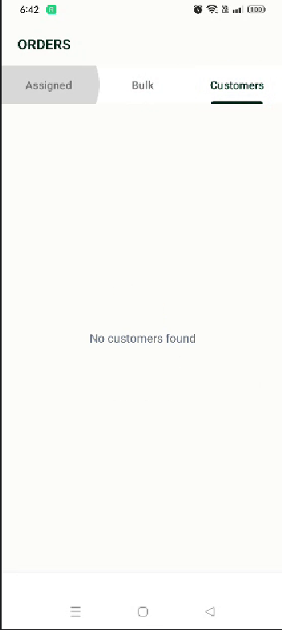 | 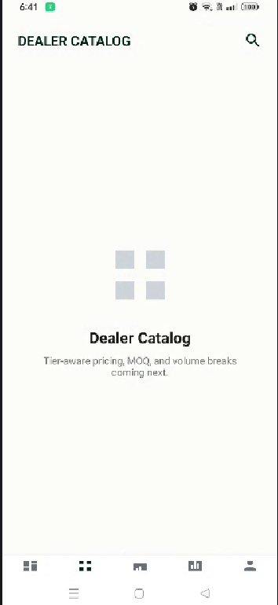 |

### 🔔 Notifications

| Notifications Inbox |
|---|
| 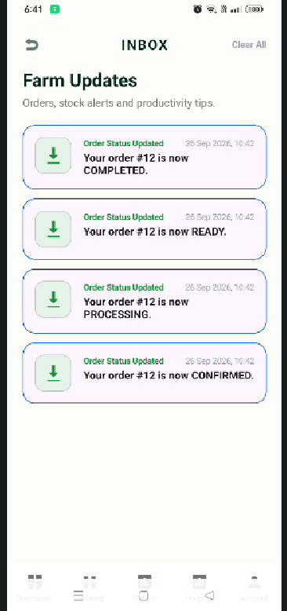 |

---

## 🔐 Security Practices

- **JWT-based stateless authentication** — no server-side sessions
- **Bcrypt password hashing** (cost factor 12)
- **OTPs hashed before storage** — never stored in plaintext
- **Per-destination rate limiting** on OTP requests (3 requests/hour)
- **Attempt-limited verification** (5 failed attempts invalidates the code)
- **RBAC enforced server-side** — every protected route checks permissions via `RbacGuard`
- **Soft deletes** preserve referential integrity for audit trails
- **Configurable expiry** on verification codes (10-minute TTL)
- **Secrets loaded from environment variables** — never committed
- **Validated order state transitions** — prevents invalid workflow jumps
- **Automatic inventory reconciliation** — stock adjusts on confirm/cancel
- **Role-change audit log** — every promotion, demotion, or suspension recorded

---

## 🗺️ Roadmap

### ✅ Completed

- [x] Role-based access control (RBAC) — 4 roles, 25+ permissions
- [x] JWT authentication with bcrypt password hashing
- [x] Two-step registration with OTP verification (email + SMS)
- [x] Product image uploads with MIME validation
- [x] Order state machine with validated transitions
- [x] Dockerized stack — PostgreSQL 18 + Ktor backend
- [x] Auto-seeded database via `docker-entrypoint-initdb.d`
- [x] GitHub Actions CI pipeline
- [x] Full source-available license

### 🚧 In Progress

- [ ] Integration test suite for critical flows
- [ ] Expanded API documentation with OpenAPI/Swagger

### 🎯 Planned

- [ ] Migrate in-memory pending auth storage to Redis (for horizontal scaling)
- [ ] Push notifications via Firebase Cloud Messaging
- [ ] Dealer bulk-order validation on the client
- [ ] Multi-currency support for cross-border expansion
- [ ] End-to-end test coverage with Espresso

---

## 👤 Author

**Movin Onyango**

- GitHub: [@Movin-onyango](https://github.com/Movin-onyango)
- LinkedIn: [movin-odhiambo-749684273](https://www.linkedin.com/in/movin-odhiambo-749684273)
- Email: movinoscar45@gmail.com

---

## 📚 Documentation

- [REST API Reference](docs/api.md) — full endpoint listing with request/response schemas
- [Architecture Deep Dive](docs/architecture.md) — design decisions, data flow, and rationale
- [MkulimaFeeds Portfolio PDF](MkulimaFeeds-Folio.pdf) — complete code walkthrough

---

## 📄 License

This project is **source-available** for portfolio and evaluation purposes only. See [LICENSE](./LICENSE) for full terms.

© 2026 Movin Onyango. All Rights Reserved.

**You may:** read, study, reference, and learn from the code.

**You may not:** use it commercially, redistribute it as your own, or republish any substantial portion without written permission.

For commercial licensing inquiries, contact: **movinoscar45@gmail.com**